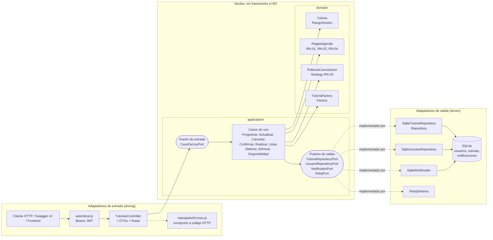
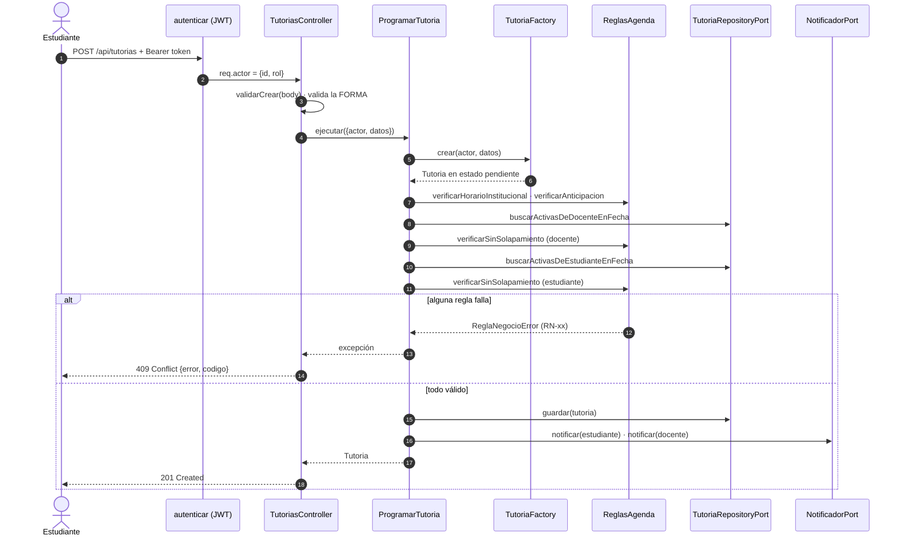

# Documento de Arquitectura — Módulo Agenda de Tutorías

**Proyecto:** ConectaProfe · **Módulo:** Agenda de Tutorías · **Estilo arquitectónico:** Hexagonal (Puertos y Adaptadores)
**Stack:** Node.js 20+, Express 4, SQLite (`better-sqlite3`), JWT, OpenAPI 3

---

## 1. Introducción y alcance

ConectaProfe es un sistema de seguimiento académico en el que estudiantes y docentes programan tutorías. En la versión inicial, la lógica de tutorías residía en `tutoriasController.js`, donde un mismo archivo recibía la petición HTTP, ejecutaba SQL, evaluaba reglas de negocio (solape de horario, anticipación de cancelación) y creaba notificaciones. Este documento describe la reestructuración del módulo bajo **Arquitectura Hexagonal**, de modo que las reglas de negocio queden aisladas del framework web y de la base de datos.

### 1.1 Regla de negocio no trivial

Una tutoría solo es válida si cumple, de forma conjunta:

| Código | Regla |
|---|---|
| RN-01 | Ni el docente ni el estudiante pueden tener otra tutoría **activa** cuyo rango horario se **superponga** (intervalos semiabiertos `[inicio, fin)`). |
| RN-02 | Se programa con al menos 2 h de anticipación y nunca en el pasado. |
| RN-03 | El plazo para cancelar o reprogramar depende del rol (estudiante 24 h, docente 12 h, administrador sin límite). |
| RN-04 | La tutoría debe quedar dentro del horario institucional (06:00–22:00, hora de Colombia). |
| RN-05 | Solo son válidas las transiciones de estado `pendiente → confirmada → completada` y `cancelar` desde estados activos. |
| RN-06 | No se puede marcar como realizada una tutoría que aún no ha comenzado. |

La regla RN-01 es la no trivial: exige comparar **rangos** (no horas puntuales como en la versión original, que solo detectaba coincidencia exacta de `hora`), considerar a **dos** actores (docente y estudiante) y excluir la propia tutoría al reprogramar.

---

## 2. Justificación: Arquitectura Hexagonal frente a MVC

### 2.1 El problema observado en el código de partida

El controlador original mezclaba cuatro responsabilidades: (1) leer `req`/`res`, (2) validar datos, (3) ejecutar SQL con `better-sqlite3` y (4) decidir reglas de negocio. Consecuencias concretas:

- Para probar la regla "no se solapan tutorías" era necesario levantar Express **y** una base de datos.
- La regla de solape solo comparaba `hora` exacta; un cambio hacia rangos exigía tocar SQL y controlador a la vez.
- El cálculo de plazos usaba `new Date('${fecha}T${hora}')`, que interpreta la fecha en la zona horaria **del servidor**: en un contenedor Docker (UTC) el comportamiento cambia respecto al equipo de desarrollo.

### 2.2 Comparación

| Criterio | MVC clásico | Hexagonal (elegida) |
|---|---|---|
| **Ubicación de la lógica de negocio** | Tiende a acumularse en el controlador o en el modelo acoplado al ORM/SQL | En un núcleo (`domain/` + `application/`) sin dependencias externas |
| **Dirección de las dependencias** | Controlador → Modelo → BD (el negocio depende de la tecnología) | Adaptadores → Puertos → Núcleo (la tecnología depende del negocio) |
| **Testabilidad** | Pruebas de negocio suelen requerir HTTP y BD | Casos de uso se prueban con dobles en memoria, sin servidor ni BD |
| **Reemplazo de tecnología** | Cambiar de BD o de framework toca varias capas | Se escribe un adaptador nuevo; el núcleo no cambia |
| **Múltiples puntos de entrada** | Difícil (cada uno duplica lógica) | Un mismo caso de uso sirve a REST, CLI, colas, etc. |
| **Curva de aprendizaje / volumen de código** | Baja; menos archivos | Mayor; más clases e interfaces (puertos) |
| **Adecuación a CRUD simple** | Excelente | Sobredimensionado si no hay reglas de negocio |

### 2.3 Por qué se descartó MVC

1. **El dominio tiene reglas reales** (RN-01 a RN-06). Cuando existe lógica de negocio rica, MVC invita a colocarla en el controlador o a dispersarla en modelos acoplados al acceso a datos.
2. **Se exige verificabilidad:** las reglas dependientes del tiempo (RN-02, RN-03) solo son comprobables de forma determinista si el reloj es una dependencia inyectada, algo natural en Hexagonal (`RelojPort`) y forzado en MVC.
3. **Evolución prevista:** el sistema ya cambió de MySQL a SQLite (ver `README` de ConectaProfe, "Bug #2"). Un cambio de motor en MVC obligó a modificar el backend; en Hexagonal habría sido un adaptador nuevo.

### 2.4 Desventajas asumidas de Hexagonal

- **Más archivos y más indirección** (puertos, adaptadores, contenedor de composición) para un módulo pequeño.
- **Mapeo entre representaciones** (fila SQL ⇄ entidad ⇄ DTO/JSON), con el costo de código repetitivo.
- **Riesgo de sobreingeniería** si el módulo fuera solo un CRUD. Aquí se justifica por la densidad de reglas.
- JavaScript no tiene interfaces: los puertos se expresan como clases base cuyos métodos lanzan "no implementado". La disciplina se refuerza con una **prueba de arquitectura automática** (§5.3).

---

## 3. Diagramas

### 3.1 Puertos y Adaptadores



> **Lectura:** las flechas continuas de `application/` hacia `domain/` y de los adaptadores hacia los puertos muestran la **regla de dependencia**: todo apunta hacia el núcleo. `contenedor.js` es el único archivo que conoce a la vez puertos e implementaciones.

### 3.2 Secuencia de `POST /api/tutorias`



---

## 4. Estructura del proyecto

```
agenda-tutorias/
├── src/
│   ├── domain/                       ← NÚCLEO. Cero dependencias externas
│   │   ├── entities/Tutoria.js           Entidad con su máquina de estados (RN-05, RN-06)
│   │   ├── value-objects/
│   │   │   ├── RangoHorario.js           VO inmutable: fecha+hora+duración; calcula solapes (RN-01)
│   │   │   └── Catalogos.js              Rol, EstadoTutoria, Modalidad (congelados)
│   │   ├── services/ReglasAgenda.js      Reglas que involucran varias tutorías (RN-01, 02, 04)
│   │   ├── policies/PoliticasCancelacion.js   STRATEGY de RN-03 + selector por rol
│   │   ├── factories/TutoriaFactory.js   FACTORY: quién crea define partes y estado inicial
│   │   └── errors/ErroresDominio.js      ValidacionError, ProhibidoError, NoEncontradoError, ReglaNegocioError
│   ├── application/                  ← CASOS DE USO. Solo depende de domain/
│   │   ├── ports/in/CasoDeUsoPort.js         Puerto de entrada (contrato de todo caso de uso)
│   │   ├── ports/out/                        Puertos de salida: Tutoria/Usuario Repository, Notificador, Reloj
│   │   └── use-cases/                        Programar, Actualizar, Cancelar, Confirmar, Realizar,
│   │                                         Listar, Obtener, Eliminar, ConsultarDisponibilidad
│   │                                         + cargarTutoriaGestionable (helper DRY)
│   ├── infrastructure/               ← TECNOLOGÍA. Puede importar hacia adentro
│   │   ├── adapters/in/http/                 Adaptador de entrada REST
│   │   │   ├── controllers/TutoriasController.js
│   │   │   ├── dtos/TutoriaDtos.js           Validación de forma + presentador JSON
│   │   │   ├── middlewares/autenticar.js, manejadorErrores.js
│   │   │   ├── routes/tutorias.routes.js
│   │   │   ├── docs/openapi.js               Swagger / OpenAPI 3
│   │   │   └── crearApp.js
│   │   ├── adapters/out/                     Adaptadores de salida
│   │   │   ├── persistence/SqliteTutoriaRepository.js, SqliteUsuarioRepository.js, SqliteConexion.js
│   │   │   ├── notifications/SqliteNotificador.js
│   │   │   └── clock/RelojSistema.js
│   │   ├── composition/contenedor.js         Raíz de composición: único lugar que "enchufa" todo
│   │   └── config/env.js                     Lectura y validación de variables de entorno
│   └── main.js                       ← Arranque
├── tests/                            ← domain · application (dobles en memoria) · infrastructure (E2E) · architecture
├── scripts/seed.js                   ← Usuarios de demostración + tokens JWT
├── docs/                             ← Este documento y la guía de sustentación
├── Dockerfile · docker-compose.yml · .env.example · package.json
```

---

## 5. Tabla de evidencia

### 5.1 Principios SOLID, DRY y KISS

| Principio / Patrón | Archivo y Clase | Problema que resuelve | Explicación técnica |
|---|---|---|---|
| **SRP** (Responsabilidad Única) | `TutoriasController` · `ReglasAgenda` · `SqliteTutoriaRepository` · `manejadorErrores` | El controlador original hacía HTTP, validación, SQL y negocio en un mismo archivo | Cada clase tiene una única razón de cambio: el controlador solo traduce HTTP ⇄ casos de uso; `ReglasAgenda` solo decide reglas; el repositorio solo mapea fila ⇄ entidad; `manejadorErrores` es el único lugar que mapea excepciones a códigos HTTP. |
| **OCP** (Abierto/Cerrado) | `SelectorPoliticaCancelacion` y `PoliticaCancelacion` (`PoliticasCancelacion.js`) | Agregar un rol con plazo propio obligaba a modificar `if (rol === …)` en el caso de uso | Un rol nuevo (p. ej. "coordinador") se añade creando una política y registrándola en `contenedor.js`. `CancelarTutoria` y `ActualizarTutoria` **no se modifican**. |
| **LSP** (Sustitución de Liskov) | `PoliticaPorAnticipacion` / `PoliticaSinRestriccion`; `SqliteTutoriaRepository` / `TutoriaRepoMemoria` (en `tests/helpers/fakes.js`) | Código cliente que falla al cambiar de implementación | Toda implementación respeta el contrato de su puerto, de modo que el caso de uso funciona igual con SQLite que con el repositorio en memoria de las pruebas (41 pruebas lo comprueban). |
| **ISP** (Segregación de Interfaces) | `UsuarioRepositoryPort` (solo `buscarPorId`) · `CasoDeUsoPort` (solo `ejecutar`) | Interfaces "gordas" que obligan a implementar métodos que no se usan | El módulo de agenda solo necesita saber si un usuario existe y qué rol tiene; no se le exige el CRUD completo de usuarios. |
| **DIP** (Inversión de Dependencias) | `ProgramarTutoria` (constructor) y `contenedor.js` | El negocio dependía de `better-sqlite3` y de `Date.now()` | Los casos de uso reciben **puertos** por constructor; nunca importan SQLite ni Express. `contenedor.js` decide qué adaptador concreto se inyecta. Lo verifica `tests/architecture.test.js`. |
| **DRY** | `RangoHorario.errores()` · `cargarTutoriaGestionable` · `ReglasAgenda` · `manejadorErrores` | Validaciones y bloques 404/403 repetidos | `RangoHorario.errores()` la reutilizan el DTO y el constructor; `cargarTutoriaGestionable` lo usan 6 casos de uso; `ConsultarDisponibilidad` reutiliza las mismas reglas que `ProgramarTutoria`; reprogramar reutiliza la estrategia de cancelación (RN-03). |
| **KISS** | Todo el proyecto | Complejidad innecesaria | Sin ORM, sin contenedor de inyección de dependencias de terceros, sin CQRS; funciones puras para las reglas; composición manual en un solo archivo de ~60 líneas. |

### 5.2 Patrones de diseño y estilo arquitectónico

| Principio / Patrón | Archivo y Clase | Problema que resuelve | Explicación técnica |
|---|---|---|---|
| **Repository** | `TutoriaRepositoryPort` (puerto) → `SqliteTutoriaRepository` (adaptador) | El SQL estaba incrustado en el controlador; el negocio no podía probarse sin BD | El núcleo pide y guarda **entidades** de dominio mediante una interfaz de colección; el SQL queda encapsulado. Cambiar de motor = escribir otra clase que implemente el mismo puerto. |
| **Strategy** | `PoliticaCancelacion` → `PoliticaPorAnticipacion`, `PoliticaSinRestriccion`; selector `SelectorPoliticaCancelacion` | RN-03 varía según el rol (24 h / 12 h / sin límite) y puede evolucionar | Cada política encapsula un algoritmo `verificar(tutoria, ahoraMs)` intercambiable. Se usa en **dos** casos de uso (`CancelarTutoria`, `ActualizarTutoria`). |
| **Factory** | `TutoriaFactory.crear()` | Crear una tutoría depende de **quién** la crea: cambian las partes y el estado inicial (`pendiente` vs `confirmada`), y no debe confiarse en el `estudiante_id` del body (suplantación) | La fábrica centraliza esa decisión; el actor del token manda y un body contradictorio produce `403`. |
| **Puertos y Adaptadores** | `application/ports/*` ⇄ `infrastructure/adapters/*` | Acoplamiento del negocio a la tecnología | Los puertos son contratos definidos por el núcleo; los adaptadores los implementan. `contenedor.js` los conecta. |
| **Value Object** | `RangoHorario` | Aritmética de fechas dispersa y propensa a errores | Objeto inmutable (`Object.freeze`) que concentra el cálculo de inicio/fin y de solape. |
| **Entidad con máquina de estados** | `Tutoria` | Estados modificados desde cualquier parte | Los cambios de estado pasan solo por `confirmar()`, `cancelar()`, `completar()`; las transiciones inválidas lanzan RN-05/RN-06. |

### 5.3 Evidencia ejecutable

| Evidencia | Dónde | Qué demuestra |
|---|---|---|
| Prueba de arquitectura | `tests/architecture.test.js` | `domain/` y `application/` no importan Express, SQLite, JWT ni `infrastructure/`; los adaptadores no contienen reglas de negocio. Se ejecuta con `npm test`. |
| Casos de uso con dobles en memoria | `tests/application/casosDeUso.test.js` | Las reglas se prueban sin servidor ni base de datos. |
| API de extremo a extremo | `tests/infrastructure/api.test.js` | CRUD, endpoints de negocio y códigos 200/201/400/401/403/404/409 sobre Express + SQLite + JWT reales. |

---

## 6. Requisitos no funcionales

### 6.1 Mantenibilidad
- **Cambio localizado:** cambiar el plazo de cancelación de un rol es una variable de entorno; agregar un rol es una clase y una línea en `contenedor.js`.
- **Reglas nombradas (RN-01…RN-06)** presentes en el código, en las respuestas (`codigo`), en Swagger y en las pruebas, lo que permite trazar cada regla de punta a punta.
- **Regla de dependencia protegida por una prueba automática**, que impide el deterioro de la arquitectura por descuido.
- **Configuración centralizada** (`config/env.js`) con validación; el dominio nunca lee `process.env`.

### 6.2 Seguridad
- **Autenticación:** Bearer JWT verificado con `jsonwebtoken`, fijando el algoritmo `HS256` (evita ataques de confusión de algoritmo) y validando que el payload tenga `id` entero y `rol` conocido. En producción, `JWT_SECRET` es obligatorio (el proceso no arranca sin él).
- **Autorización por recurso (403)** en los casos de uso: cada quien accede solo a sus tutorías; solo el docente asignado confirma o completa; solo el administrador elimina.
- **Anti-suplantación:** la identidad del estudiante/docente sale del **token**, no del body (`TutoriaFactory`); el alcance de `GET /tutorias` lo impone el caso de uso y los filtros no pueden ampliarlo.
- **Validación estricta de entrada** (DTOs) con mensajes por campo; límite de tamaño del cuerpo (100 kb).
- **SQL parametrizado** en todos los valores provenientes del usuario.
- **Errores controlados:** los fallos inesperados devuelven `500` genérico sin filtrar detalles internos.
- *No incluido (alcance académico):* *rate limiting*, `helmet`, revocación/rotación de tokens.

### 6.3 Escalabilidad y testabilidad
- **Testabilidad:** 41 pruebas; el reloj es inyectable (`RelojPort`), por lo que RN-02 y RN-03 se prueban de forma determinista en milisegundos.
- **Portabilidad de tecnología:** los puertos ya son asíncronos (devuelven promesas), de modo que pasar a PostgreSQL implica un nuevo adaptador y cambiar una línea en `contenedor.js`; los casos de uso no cambian.
- **Independencia de zona horaria:** `RangoHorario` fija el offset institucional (UTC-5), por lo que el servidor puede correr en UTC (Docker) sin alterar el resultado de las reglas.
- **Escalado horizontal:** el servicio no guarda estado en memoria (JWT *stateless*), pero SQLite es un archivo local con un único escritor; para varias instancias debe sustituirse por un motor cliente-servidor (ver 6.4).

### 6.4 Limitaciones conocidas y trabajo futuro

1. **Concurrencia (RN-01).** La verificación de solape (consultar) y el guardado (insertar) son pasos separados. En esta implementación, con un solo proceso Node y `better-sqlite3` síncrono, las promesas implicadas se resuelven sin E/S real y no hay intercalado entre peticiones; sin embargo **no es una garantía de diseño**. Con varias instancias o un motor remoto dos solicitudes simultáneas podrían crear tutorías solapadas. Mitigación recomendada: en PostgreSQL, una *exclusion constraint* sobre `tstzrange` (`EXCLUDE USING gist (docente_id WITH =, rango WITH &&) WHERE (estado IN ('pendiente','confirmada'))`) o una transacción `SERIALIZABLE`.
2. **Paginación:** el listado se limita a 200 registros.
3. **Datos heredados:** las tutorías anteriores no tienen duración; se asume 60 min. Un registro antiguo que viole invariantes del dominio (p. ej. hora inválida) provocaría error al leerse.
4. **Identidad:** el módulo no emite tokens; depende del login de ConectaProfe.

---

## 7. Conclusión

La reestructuración separa **qué hace el negocio** (dominio y casos de uso) de **cómo se expone y se persiste** (adaptadores). El costo es mayor cantidad de archivos e indirección; el beneficio es un núcleo verificable en milisegundos, reglas trazables, y la posibilidad de cambiar de base de datos o de interfaz sin reescribir la lógica. Para un módulo con seis reglas de negocio interdependientes, esa relación costo-beneficio justifica la arquitectura elegida.
